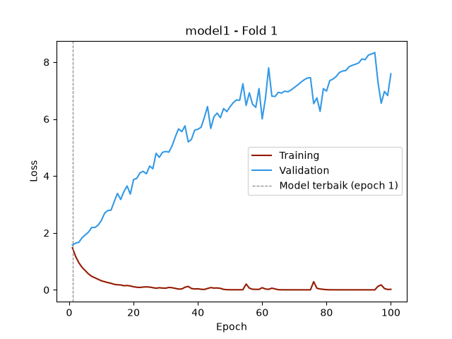
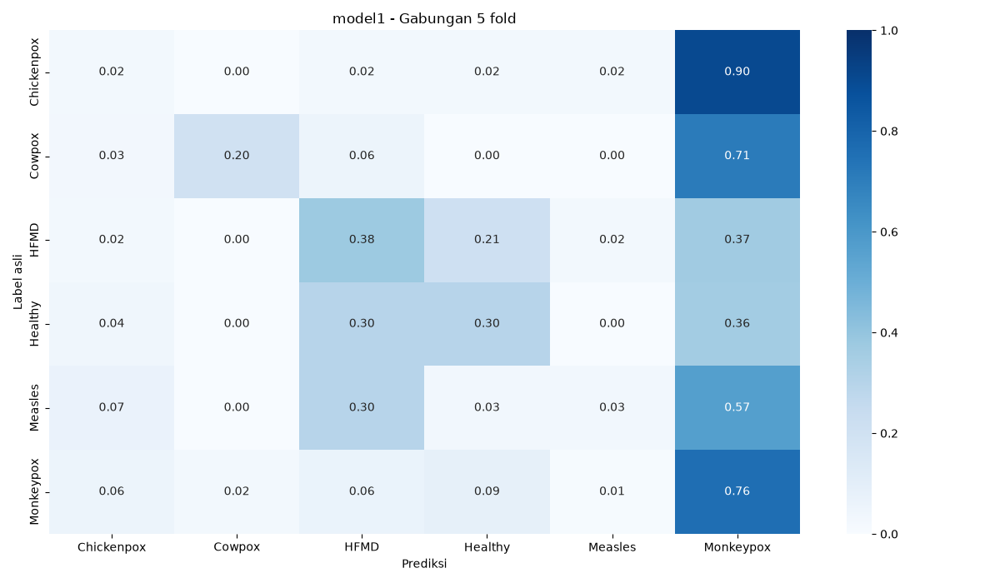
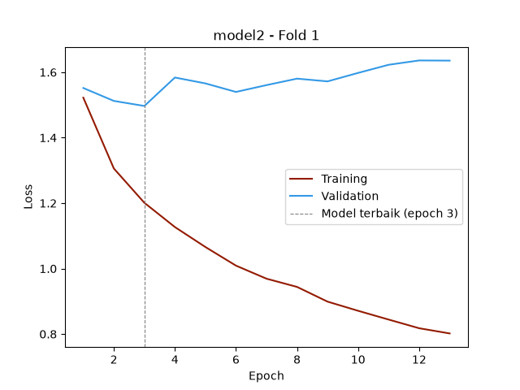
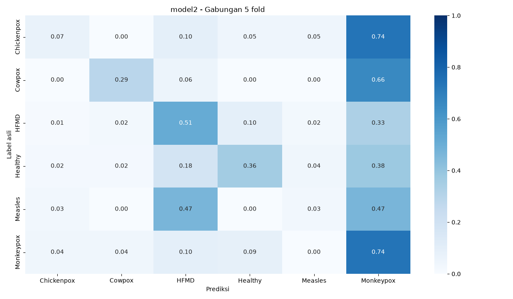
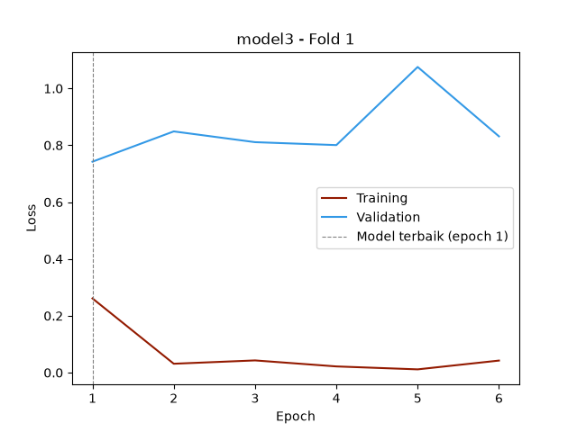
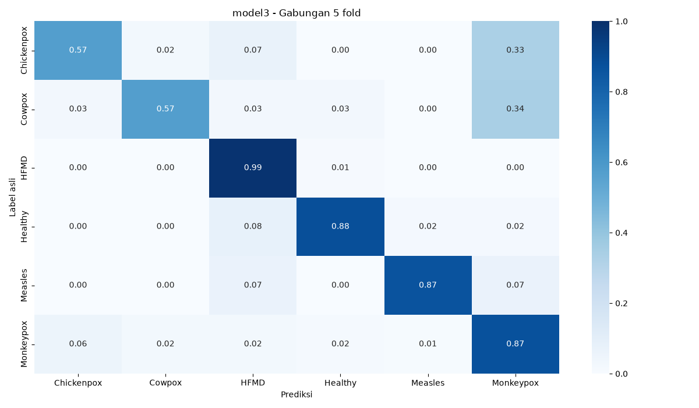

# Klasifikasi Lesi Kulit Mpox dengan Deep Learning (MSLD v2.0)

Repositori ini berisi kode dan laporan tugas klasifikasi citra lesi kulit ke dalam enam kelas: Chickenpox, Cowpox, HFMD (Hand, Foot, and Mouth Disease), Healthy, Measles, dan Monkeypox. Dataset yang dipakai adalah [Mpox Skin Lesion Dataset Version 2.0 (MSLD v2.0)](https://www.kaggle.com/datasets/joydippaul/mpox-skin-lesion-dataset-version-20-msld-v20). Semua model dievaluasi dengan 5-fold cross validation, dan setiap metrik dilaporkan sebagai rata-rata ± simpangan baku dari kelima fold.

Tiga model dibandingkan:

| Model | Deskripsi |
|---|---|
| Model 1 | SimpleCNN, sama dengan arsitektur pada materi kuliah |
| Model 2 | SimpleCNN dengan tambahan regularisasi (BatchNorm dan Dropout) |
| Model 3 | ConvNeXt-Tiny dengan bobot pretrained ImageNet (transfer learning) |

Model 3 memberikan hasil terbaik dengan accuracy 0,837 ± 0,032, F1 macro 0,813 ± 0,042, dan ROC-AUC 0,974 ± 0,009. Model 1 dan Model 2 hanya mencapai accuracy 0,411 dan 0,456.

## 1. Dataset

### 1.1 Isi dataset

MSLD v2.0 berisi 755 gambar kulit asli dari sekitar 540 pasien. Jumlah gambar per kelas tidak seimbang:

| Kelas | Kode file | Gambar asli | Porsi |
|---|---|---|---|
| Monkeypox | MKP | 284 | 38% |
| HFMD | HFMD | 161 | 21% |
| Healthy | HEALTHY | 114 | 15% |
| Chickenpox | CHP | 75 | 10% |
| Cowpox | CWP | 66 | 9% |
| Measles | MSL | 55 | 7% |

Nama file mengikuti format `KODE_pasien_gambar.jpg`, misalnya `CHP_01_01.jpg` adalah gambar pertama dari pasien Chickenpox nomor 01.

### 1.2 Pembagian fold dan aturan penggunaan data

Pembuat dataset sudah membagi data menjadi 5 fold. Di setiap fold, seluruh 755 gambar asli dibagi ke Train, Valid, dan Test. Pembagian ini berbasis pasien: tidak ada ID pasien yang muncul di lebih dari satu bagian pada fold yang sama.

Sesuai ketentuan tugas:

- **Train** = Train dari `Original Images` + Train dari `Augmented Images` pada fold yang sama.
- **Valid** dan **Test** hanya dari `Original Images`, dan tidak pernah dipakai untuk melatih model.

Folder augmented berisi 14 file untuk setiap gambar Train asli: 13 hasil augmentasi (akhiran `_1` sampai `_13`, berupa rotasi, translasi, pencerminan, dan perubahan warna) dan 1 salinan gambar asli (akhiran `_ORIGINAL`). File `_ORIGINAL` dilewati karena gambar aslinya sudah dibaca dari folder Train asli.

Jumlah gambar yang dipakai per fold (setelah filter gambar kembar, lihat bagian 2.1):

| Fold | Train asli | Train dipakai (asli + augmented) | Valid | Test |
|---|---|---|---|---|
| 1 | 536 | 7.504 | 144 | 74 |
| 2 | 508 | 7.112 | 164 | 82 |
| 3 | 535 | 7.490 | 153 | 64 |
| 4 | 520 | 7.280 | 150 | 81 |
| 5 | 535 | 7.490 | 154 | 63 |

Walaupun data Train berjumlah sekitar 7.000 sampai 7.500 gambar, isinya hanya berasal dari sekitar 530 gambar asli yang masing-masing muncul dalam 14 versi. Hal ini berpengaruh besar terhadap perilaku pelatihan (bagian 9).

## 2. Temuan pada dataset

Sebelum melatih model, dataset diperiksa secara langsung. Ada tiga temuan yang memengaruhi preprocessing dan cara membaca hasil.

### 2.1 Gambar kembar dengan ID pasien berbeda

Ada empat pasangan gambar yang identik atau hampir identik, tetapi tercatat dengan ID pasien yang berbeda:

| Pasangan | Keterangan |
|---|---|
| `CHP_26_01` dan `CHP_62_01` | File identik (hash MD5 sama) |
| `HEALTHY_21_01` dan `HEALTHY_77_01` | Hampir identik |
| `HFMD_96_01` dan `HFMD_130_01` | Hampir identik, resolusi berbeda |
| `CWP_31_01` dan `CWP_02_01` | Hampir identik, resolusi berbeda |

Karena fold dibagi berdasarkan ID pasien, kedua gambar dalam satu pasangan bisa terpisah ke Train dan Test. Artinya, model bisa dilatih dengan gambar yang sama dengan gambar ujinya. Untuk mencegah kebocoran ini, gambar Train yang kembarannya ada di Valid atau Test pada fold yang sama dilewati, beserta 13 versi augmented-nya. Jumlah gambar asli yang dilewati per fold adalah 1, 1, 3, 4, dan 3 (fold 1 sampai 5). Valid dan Test tidak diubah.

Langkah ini sedikit menyimpang dari aturan "seluruh Train asli dan augmented dipakai", tetapi sesuai dengan maksud aturan bahwa data uji tidak boleh dipakai untuk melatih model.

### 2.2 Pasangan lintas kelas yang mirip

Gambar `CHP_38_01` (Chickenpox) sangat mirip dengan `MKP_20_01` dan `MKP_20_02` (Monkeypox). Belum dapat dipastikan apakah ketiganya berasal dari orang yang sama. Jika ya, berarti ada label yang bertentangan di dataset. Pasangan ini hanya dicatat dan tidak diubah.

### 2.3 Resolusi asli berkaitan dengan kelas

Lebar asli gambar sangat berbeda antarkelas:

| Kelas | Lebar < 224 | Lebar = 224 | Lebar > 224 |
|---|---|---|---|
| Chickenpox | 0 | 75 (100%) | 0 |
| Cowpox | 48 (73%) | 0 | 18 (27%) |
| HFMD | 18 (11%) | 3 (2%) | 140 (87%) |
| Healthy | 28 (25%) | 64 (56%) | 22 (19%) |
| Measles | 0 | 38 (69%) | 17 (31%) |
| Monkeypox | 15 (5%) | 267 (94%) | 2 (1%) |

Sebagai uji, dibuat aturan sederhana yang hanya melihat lebar gambar tanpa melihat isinya (lebar < 224 ditebak Cowpox, = 224 ditebak Monkeypox, > 224 ditebak HFMD, dipelajari dari Train setiap fold). Aturan ini mencapai accuracy rata-rata **0,553** di data Test, lebih tinggi dari Model 1 dan Model 2. Setelah di-resize, jejak resolusi tetap tersisa (gambar kecil yang diperbesar menjadi lebih buram), sehingga model bisa memanfaatkan petunjuk ini, bukan ciri lesinya. Bias ini tidak dapat dihilangkan lewat preprocessing tanpa membuang detail gambar, sehingga dicatat sebagai keterbatasan.

## 3. Preprocessing

Preprocessing dilakukan di `Utils/getData.py` dan berlaku sama untuk ketiga model:

1. Gambar dibaca dengan OpenCV, lalu diubah dari BGR ke RGB.
2. Gambar di-resize ke 100×100 (Model 1 dan 2) atau 224×224 (Model 3). Saat mengecilkan dipakai interpolasi `INTER_AREA` supaya tidak muncul aliasing, dan saat membesarkan dipakai `INTER_LINEAR`.
3. Gambar disimpan sebagai `uint8` (0 sampai 255) untuk menghemat memori, lalu dinormalisasi ke rentang 0 sampai 1 saat diambil (`__getitem__`).
4. Label diubah menjadi one-hot 6 kelas, dengan urutan kelas alfabetis.
5. File `_ORIGINAL` di folder augmented dan gambar kembar (bagian 2.1) dilewati saat memuat Train.
6. Untuk Model 3, normalisasi mean dan std ImageNet dilakukan di dalam `forward()` model, sehingga `getData.py` tetap sama untuk semua model.

## 4. Struktur program

```
├── Models/
│   ├── __init__.py
│   ├── CNN.py            # Model 1: SimpleCNN
│   ├── CNN2.py           # Model 2: SimpleCNN + regularisasi
│   └── ConvNeXt.py       # Model 3: ConvNeXt-Tiny pretrained
├── Utils/
│   ├── __init__.py
│   └── getData.py        # unduh dataset dan class getImageLabel
├── Results/              # grafik loss, confusion matrix, dan metrik per model
├── config.py             # daftar model beserta pengaturannya
├── train.py              # training 5 fold
├── test.py               # testing dan perhitungan metrik 5 fold
└── requirements.txt
```

| File | Fungsi |
|---|---|
| `Utils/getData.py` | Mengunduh dataset lewat `kagglehub` dan menyediakan class `getImageLabel` (turunan `torch.utils.data.Dataset`) yang membaca gambar sesuai fold dan bagian (Train, Valid, Test) |
| `Models/*.py` | Mendefinisikan arsitektur setiap model. Semua model menerima input `(batch, 3, tinggi, lebar)` bernilai 0 sampai 1 dan mengeluarkan log-probabilitas 6 kelas |
| `config.py` | Menyimpan pengaturan setiap model: class model, ukuran gambar, batch size, epoch, learning rate, dan patience early stopping |
| `train.py` | Melatih model di setiap fold, memantau data Valid, menyimpan model terbaik, grafik loss, dan riwayat per epoch |
| `test.py` | Menguji model terbaik setiap fold di data Test, menghitung metrik, confusion matrix, dan laporan per kelas, lalu merata-ratakan 5 fold |

File model hasil latihan (`.pt`) disimpan di folder `Checkpoints/` dan tidak diunggah ke repositori.

## 5. Metode pelatihan dan evaluasi

### 5.1 Pelatihan

| Komponen | Pengaturan |
|---|---|
| Optimizer | Adam |
| Loss function | `NLLLoss` (pasangan dari `LogSoftmax` di akhir setiap model) |
| Pemilihan model | Di setiap fold, disimpan model pada epoch dengan valid loss terendah |
| Early stopping | Latihan berhenti jika valid loss tidak membaik selama sejumlah epoch (patience), sesuai pengaturan setiap model |
| Seed | 42 |
| Perangkat | NVIDIA GeForce RTX 4060 Laptop GPU (8 GB) |

Di setiap fold, model dibuat ulang dari awal, sehingga kelima fold merupakan lima percobaan yang terpisah. Kriteria pemilihan model (valid loss) dipakai sama untuk ketiga model.

### 5.2 Evaluasi

Model terbaik dari setiap fold diuji satu kali di data Test fold tersebut. Metrik yang dihitung:

- **Accuracy**
- **Precision, recall, dan F1** dengan rata-rata *macro*, karena kelasnya tidak seimbang. Rata-rata macro memberi bobot yang sama untuk setiap kelas.
- **ROC-AUC** multi-kelas (*one-vs-rest*, rata-rata macro), dihitung dari probabilitas setiap kelas.
- **Confusion matrix**, dinormalisasi per baris (proporsi tebakan untuk setiap kelas asli).

Nilai akhir adalah rata-rata ± simpangan baku dari 5 fold.

### 5.3 Perbedaan dengan kode materi

Struktur kode (folder `Models/` dan `Utils/`, class `getImageLabel`, class `SimpleCNN`, serta pola `train.py` dan `test.py`) mengikuti materi kuliah. Perubahannya:

| Aspek | Materi | Proyek ini | Alasan |
|---|---|---|---|
| Pembagian data | Train dan Test memakai folder yang sama | Train, Valid, dan Test terpisah, 5-fold | Ketentuan tugas, dan supaya penilaian tidak bias |
| Jumlah kelas | 5 | 6 | Sesuai dataset |
| Loss function | `CrossEntropyLoss` | `NLLLoss` | `NLLLoss` adalah pasangan eksplisit untuk output `LogSoftmax`. Secara hasil keduanya sama, karena log-softmax yang diterapkan dua kali menghasilkan nilai yang sama |
| Penyimpanan model | Setiap 50 epoch | Epoch dengan valid loss terendah di setiap fold | Supaya model yang diuji adalah model terbaik menurut data Valid |
| Perangkat | CPU | GPU (CUDA) | Mempercepat latihan |
| Preprocessing | Resize dan normalisasi | Ditambah konversi BGR ke RGB, `INTER_AREA`, penyimpanan `uint8`, dan filter gambar kembar | Lihat bagian 3 |
| Metrik | Confusion matrix, accuracy, precision, recall, F1 | Ditambah ROC-AUC, rata-rata macro, dan rata-rata ± std 5 fold | Ketentuan tugas |
| Pengaturan | Ditulis langsung di `train.py` | Dikumpulkan di `config.py` | Supaya ketiga model memakai `train.py` dan `test.py` yang sama |

## 6. Model

### 6.1 Model 1: SimpleCNN

Arsitektur sama persis dengan materi kuliah, hanya jumlah output diubah menjadi 6 kelas.

| Lapisan | Isi | Ukuran output |
|---|---|---|
| Input | Gambar RGB | (B, 3, 100, 100) |
| Blok konvolusi 1 | Conv2d 3 → 20 (kernel 5×5), ReLU, MaxPool 3×3 | (B, 20, 32, 32) |
| Blok konvolusi 2 | Conv2d 20 → 50 (kernel 5×5), ReLU, MaxPool 3×3 | (B, 50, 9, 9) |
| Klasifikasi | Flatten, Linear 4.050 → 6, LogSoftmax | (B, 6) |

Jumlah parameter: 50.876. Pengaturan latihan mengikuti materi: gambar 100×100, batch 32, learning rate 0,001, 100 epoch per fold, tanpa early stopping.

### 6.2 Model 2: SimpleCNN dengan regularisasi

Model 2 memakai SimpleCNN yang sama, ditambah lapisan regularisasi untuk mengurangi overfitting yang terlihat jelas pada Model 1 (bagian 9.1):

| Lapisan | Isi | Ukuran output |
|---|---|---|
| Input | Gambar RGB | (B, 3, 100, 100) |
| Blok konvolusi 1 | Conv2d 3 → 20 (kernel 5×5), **BatchNorm2d**, ReLU, MaxPool 3×3, **Dropout2d 0,1** | (B, 20, 32, 32) |
| Blok konvolusi 2 | Conv2d 20 → 50 (kernel 5×5), **BatchNorm2d**, ReLU, MaxPool 3×3, **Dropout2d 0,1** | (B, 50, 9, 9) |
| Klasifikasi | Flatten, **Dropout 0,5**, Linear 4.050 → 6, LogSoftmax | (B, 6) |

Jumlah parameter: 51.016. Fungsi setiap tambahan:

- **BatchNorm2d** menormalkan keluaran setiap konvolusi, sehingga latihan lebih stabil dan memberi efek regularisasi ringan.
- **Dropout2d** mematikan seluruh feature map secara acak selama latihan, sehingga model tidak bergantung pada pola tertentu.
- **Dropout sebelum Linear** mencegah lapisan klasifikasi menghafal kombinasi fitur dari data Train.

Pengaturan latihan juga disesuaikan berdasarkan hasil Model 1:

| Pengaturan | Model 1 | Model 2 | Alasan |
|---|---|---|---|
| Learning rate | 0,001 | 0,0001 | Pada Model 1, valid loss terendah sudah tercapai di epoch 1 sampai 2, lalu model mulai menghafal. Langkah belajar yang 10 kali lebih kecil membuat pembelajaran lebih bertahap |
| Batch size | 32 | 16 | Pembaruan bobot dua kali lebih sering per epoch, mengimbangi learning rate yang lebih kecil, dan gradien yang sedikit lebih bervariasi memberi efek regularisasi ringan |
| Epoch | 100 | 30 | Pada Model 1, epoch setelah epoch 2 tidak memperbaiki valid loss. Model 2 diberi lebih banyak epoch dari titik terbaik Model 1 karena belajar lebih lambat, tetapi tidak sampai 100 |
| Early stopping | Tidak ada | Patience 10 | Menghentikan latihan saat valid loss tidak lagi membaik. Patience dibuat cukup panjang karena valid loss pada model dengan dropout cenderung naik-turun |

### 6.3 Model 3: ConvNeXt-Tiny pretrained

Model 3 memakai ConvNeXt-Tiny dari `torchvision` dengan bobot pretrained ImageNet. ConvNeXt adalah arsitektur CNN modern, dan model ini tidak termasuk model yang dipakai pada kode project Kaggle dataset.

| Bagian | Isi |
|---|---|
| Normalisasi | Mean dan std ImageNet, dilakukan di dalam `forward()` |
| Backbone | ConvNeXt-Tiny pretrained ImageNet: 4 tahap dengan 96, 192, 384, dan 768 channel |
| Kepala klasifikasi | LayerNorm, Flatten, Linear 768 → 6 (menggantikan Linear 768 → 1.000 bawaan ImageNet) |
| Output | LogSoftmax 6 kelas |

Jumlah parameter: sekitar 27,8 juta, dan seluruhnya dilatih ulang (*fine-tuning*). Pengaturan latihan: gambar 224×224, batch 16, learning rate 0,00003, maksimal 10 epoch, early stopping dengan patience 5.

Alasan memilih transfer learning: data unik hanya sekitar 530 gambar asli per fold, dan Model 1 menunjukkan bahwa model yang dilatih dari nol langsung menghafal data Train. Model pretrained sudah mengenali pola visual umum (tepi, tekstur, warna) dari jutaan foto, sehingga hanya perlu menyesuaikan diri ke enam kelas penyakit kulit.

## 7. Pemilihan pengaturan Model 3

Pengaturan Model 3 dipilih melalui beberapa percobaan di fold 1, dinilai dengan data Valid (144 gambar). Data Test tidak dipakai dalam proses ini.

| Percobaan | Pengaturan | Epoch terbaik | Valid loss terbaik | Valid accuracy di epoch terbaik | Valid accuracy tertinggi |
|---|---|---|---|---|---|
| Awal | lr 0,0001 | 1 | 0,742 | 0,792 | 0,806 |
| A | lr 0,00003 | 1 | 0,518 | 0,819 | 0,854 |
| B | Backbone dibekukan (hanya lapisan akhir dilatih), lr 0,001 | 2 | 0,604 | 0,792 | 0,799 |
| C | lr 0,00001 | 2 | 0,539 | 0,819 | 0,861 |
| D | A + augmentasi acak di dalam model (flip, crop, perubahan warna) | 1 | 0,565 | 0,785 | 0,813 |
| A (preprocessing final) | lr 0,00003 | 1 | 0,497 | 0,813 | 0,847 |

Percobaan Awal sampai D dijalankan sebelum perbaikan preprocessing (`INTER_AREA` dan filter gambar kembar). Baris terakhir adalah percobaan A yang diulang dengan preprocessing final.

Pengamatan:

- **Menurunkan learning rate membantu.** Valid loss membaik dari 0,742 (lr 0,0001) menjadi 0,518 (lr 0,00003). Menurunkan lagi ke 0,00001 tidak memberi perbaikan berarti.
- **Membekukan backbone mencegah hafalan, tetapi membatasi kemampuan.** Train loss tetap sekitar 0,14 sampai 0,30, tetapi valid accuracy tertahan di sekitar 0,79. Artinya, fitur ImageNet saja belum cukup spesifik untuk lesi kulit, dan model tetap perlu di-fine-tune.
- **Augmentasi acak tambahan tidak membantu.** Augmentasi bawaan dataset sudah mencakup transformasi serupa, dan masalah utamanya adalah jumlah gambar unik yang sedikit.
- **Selisih antarpercobaan sebagian besar masih dalam noise.** Dengan 144 gambar Valid dan accuracy sekitar 0,82, interval kepercayaan 95% untuk accuracy kira-kira ±0,06. Selisih antara A dan C (dan sebagian besar percobaan lain) tidak dapat dibedakan secara meyakinkan.

Pengaturan A dipilih sebagai Model 3 final karena memiliki valid loss terendah dan paling sederhana.

## 8. Hasil

### 8.1 Metrik rata-rata 5 fold (data Test)

| Model | Accuracy | Precision | Recall | F1 | ROC-AUC |
|---|---|---|---|---|---|
| Baseline (selalu menebak Monkeypox) | 0,341 ± 0,032 | 0,057 | 0,167 | 0,085 | 0,500 |
| Model 1: SimpleCNN | 0,411 ± 0,057 | 0,337 ± 0,087 | 0,278 ± 0,052 | 0,264 ± 0,056 | 0,731 ± 0,033 |
| Model 2: SimpleCNN + regularisasi | 0,456 ± 0,037 | 0,442 ± 0,115 | 0,346 ± 0,038 | 0,337 ± 0,045 | 0,762 ± 0,030 |
| **Model 3: ConvNeXt-Tiny** | **0,837 ± 0,032** | **0,853 ± 0,049** | **0,802 ± 0,038** | **0,813 ± 0,042** | **0,974 ± 0,009** |

Precision, recall, dan F1 memakai rata-rata macro. Baseline adalah pembanding yang selalu menebak kelas terbanyak (Monkeypox).

### 8.2 Hasil per fold

| Fold | Baseline accuracy | Model 1 accuracy | Model 2 accuracy | Model 3 accuracy | Model 3 F1 |
|---|---|---|---|---|---|
| 1 | 0,365 | 0,486 | 0,514 | 0,797 | 0,743 |
| 2 | 0,378 | 0,341 | 0,439 | 0,854 | 0,819 |
| 3 | 0,344 | 0,391 | 0,484 | 0,828 | 0,813 |
| 4 | 0,333 | 0,469 | 0,432 | 0,815 | 0,816 |
| 5 | 0,286 | 0,365 | 0,413 | 0,889 | 0,876 |

| Model | Epoch terbaik per fold | Total waktu latihan 5 fold |
|---|---|---|
| Model 1 | 1, 2, 1, 2, 1 | sekitar 17 menit (100 epoch per fold) |
| Model 2 | 3, 3, 3, 3, 3 | sekitar 4 menit (berhenti di epoch 13 karena early stopping) |
| Model 3 | 1, 4, 1, 1, 3 | sekitar 47 menit |

### 8.3 Grafik loss dan confusion matrix

Grafik loss ditampilkan untuk fold 1. Garis putus-putus menandai epoch model terbaik. Confusion matrix adalah gabungan kelima fold, dinormalisasi per baris. Grafik dan confusion matrix untuk setiap fold tersedia di folder `Results/`.

**Model 1: SimpleCNN**

| Grafik loss (fold 1) | Confusion matrix (gabungan 5 fold) |
|---|---|
|  |  |

**Model 2: SimpleCNN + regularisasi**

| Grafik loss (fold 1) | Confusion matrix (gabungan 5 fold) |
|---|---|
|  |  |

**Model 3: ConvNeXt-Tiny**

| Grafik loss (fold 1) | Confusion matrix (gabungan 5 fold) |
|---|---|
|  |  |

## 9. Pembahasan

### 9.1 Model cepat menghafal data Train

Pada ketiga model, valid loss terendah dicapai sangat awal (epoch 1 sampai 4). Pada Model 1 fold 1, train loss turun dari 1,48 (epoch 1) ke 0,18 (epoch 15), sedangkan valid loss justru naik dari 1,58 ke 3,39. Model menghafal data Train, bukan mempelajari ciri penyakit.

Penyebab utamanya adalah komposisi data Train: sekitar 7.500 gambar per fold hanya berasal dari sekitar 530 gambar asli. Dalam satu epoch, setiap gambar asli sudah terlihat 14 kali dalam variasi berbeda, sehingga satu epoch sudah cukup bagi model untuk mulai menghafal.

### 9.2 Regularisasi pada Model 2

Regularisasi berhasil memperlambat hafalan. Pada fold 1, train loss Model 2 di epoch 13 masih 0,80, sementara Model 1 pada epoch yang sama sudah 0,23. Namun valid loss terbaik tetap tercapai di epoch 3 pada semua fold. Artinya, masalahnya bukan hanya hafalan, tetapi juga jarak antara pasien di data Train dan pasien di data Valid/Test yang tidak bisa diatasi dengan regularisasi.

Dibanding Model 1, Model 2 naik 4,5 poin pada accuracy, 7,4 poin pada F1, dan 3,2 poin pada ROC-AUC. Peningkatan ini konsisten, tetapi masih kecil dibanding variasi antar-fold.

### 9.3 Kecenderungan menebak Monkeypox

Model 1 dan Model 2 sangat condong ke kelas terbanyak. Sekitar 61% (Model 1) dan 57% (Model 2) dari seluruh tebakan adalah Monkeypox, padahal Monkeypox hanya 34% dari data Test. Akibatnya, kelas kecil hampir tidak pernah tertebak: recall Measles hanya 0,03 pada kedua model, dan recall Chickenpox 0,02 (Model 1) dan 0,07 (Model 2).

Accuracy Model 1 (0,411) hanya sekitar 7 poin di atas baseline yang selalu menebak Monkeypox (0,341). Namun F1 (0,264 vs 0,085) dan ROC-AUC (0,731 vs 0,500) menunjukkan bahwa model tetap menangkap sebagian pola, bukan sekadar menebak kelas terbanyak.

### 9.4 Transfer learning pada Model 3

Model 3 jauh lebih baik dari kedua model lain pada semua metrik, dan F1 macro (0,813) tidak jauh dari accuracy (0,837), artinya kelas kecil juga sudah tertebak dengan baik. Porsi tebakan Monkeypox turun menjadi 38%, mendekati porsi sebenarnya (34%).

Kesalahan terbesar Model 3 ada pada Chickenpox dan Cowpox: masing-masing sekitar sepertiga gambarnya ditebak sebagai Monkeypox (33% dan 34% pada confusion matrix gabungan). Ketiganya sama-sama penyakit dengan bintil pada kulit sehingga mirip secara visual, dan semua gambar Chickenpox berukuran 224 seperti sebagian besar gambar Monkeypox (bagian 2.3).

### 9.5 Perbandingan dengan hasil pembuat dataset

Pembuat dataset melaporkan accuracy terbaik 83,59 ± 2,11% dengan transfer learning yang memakai bobot pretrained dari dataset lesi kulit HAM10000. Model 3 mencapai 83,7 ± 3,2% dengan bobot ImageNet biasa. Kedua hasil sebanding, walaupun tidak sepenuhnya bisa dibandingkan langsung karena preprocessing dan perlakuan terhadap gambar kembar berbeda.

## 10. Keterbatasan

- **Ukuran data kecil.** Dataset hanya berisi sekitar 540 pasien, dan data Test per fold hanya 63 sampai 82 gambar, sehingga satu tebakan bisa mengubah accuracy sekitar 1,2 sampai 1,6 poin.
- **Penyetelan Model 3 hanya memakai Valid fold 1**, dengan satu kali percobaan (satu seed) untuk setiap pengaturan. Sebagian besar selisih antarpercobaan masih dalam noise, dan sebagian percobaan dijalankan sebelum perbaikan preprocessing.
- **Bias resolusi** (bagian 2.3) tidak dihilangkan. Sebagian performa model, terutama pada kelas dengan resolusi khas seperti HFMD (recall 0,99 pada Model 3), mungkin berasal dari petunjuk resolusi dan bukan dari ciri lesi.
- **Deteksi gambar kembar mungkin belum lengkap.** Pemeriksaan kemiripan belum tentu menangkap kembaran yang dicerminkan atau dipotong berat. Pasangan lintas kelas pada bagian 2.2 juga belum dipastikan.
- **Pemilihan model berdasarkan valid loss.** Pada beberapa percobaan, valid accuracy masih naik saat valid loss mulai naik (model makin sering benar tetapi terlalu yakin saat salah). Pemilihan berdasarkan valid macro-F1 sempat dipertimbangkan, tetapi tidak dipakai supaya kriteria tetap sama untuk ketiga model.
- **Bobot pretrained umum.** Model 3 memakai bobot ImageNet (foto umum), bukan bobot dari dataset kulit.

## 11. Kesimpulan

1. Model 3 (ConvNeXt-Tiny pretrained ImageNet) memberikan hasil terbaik dengan accuracy 0,837 ± 0,032, F1 macro 0,813 ± 0,042, dan ROC-AUC 0,974 ± 0,009, sebanding dengan hasil terbaik pembuat dataset.
2. Model yang dilatih dari nol (Model 1 dan Model 2) cepat menghafal data Train yang hanya berasal dari sekitar 530 gambar unik per fold, dan cenderung menebak kelas terbanyak (Monkeypox).
3. Regularisasi pada Model 2 memperlambat hafalan dan sedikit meningkatkan semua metrik, tetapi peningkatannya kecil dibanding transfer learning.
4. Untuk dataset kecil seperti MSLD v2.0, transfer learning dari model pretrained jauh lebih efektif daripada melatih CNN dari nol.
5. Pemeriksaan dataset menemukan gambar kembar dengan ID pasien berbeda dan keterkaitan antara resolusi gambar dan kelas, yang perlu diperhatikan saat membaca hasil pada dataset ini.

## Referensi

- Mpox Skin Lesion Dataset Version 2.0 (MSLD v2.0), Kaggle: https://www.kaggle.com/datasets/joydippaul/mpox-skin-lesion-dataset-version-20-msld-v20
- Ali, S. N., dkk. (2024). A web-based mpox skin lesion detection system using state-of-the-art deep learning models considering racial diversity. *Biomedical Signal Processing and Control*. https://arxiv.org/abs/2306.14169
- Liu, Z., dkk. (2022). A ConvNet for the 2020s. *Proceedings of the IEEE/CVF Conference on Computer Vision and Pattern Recognition (CVPR)*. https://arxiv.org/abs/2201.03545
